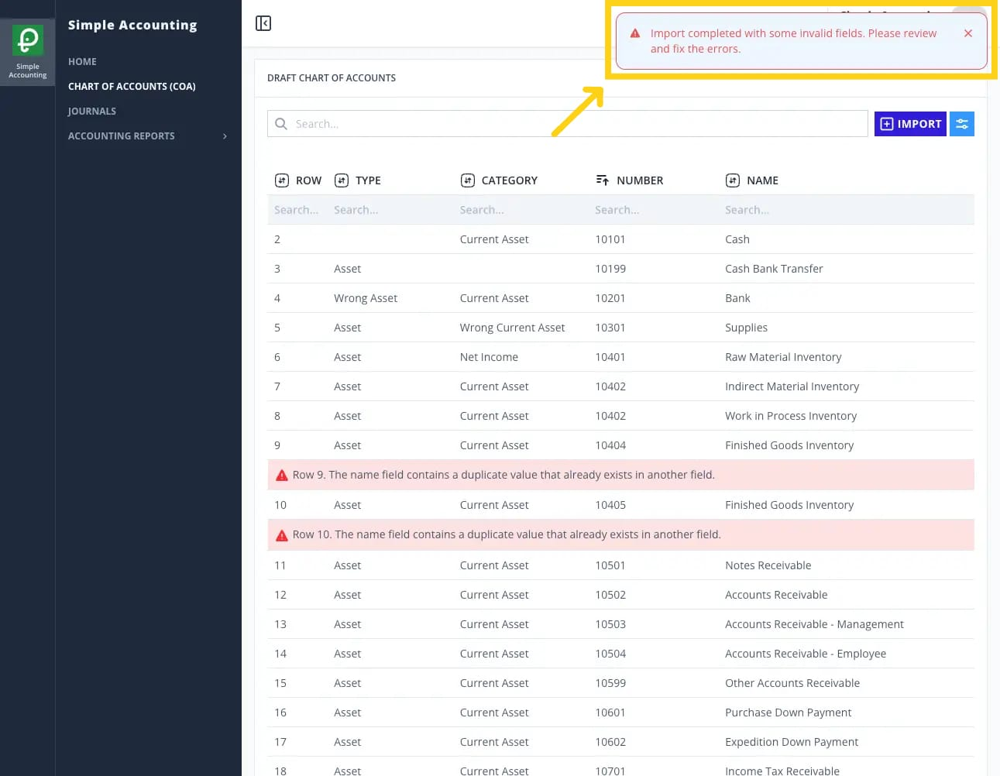
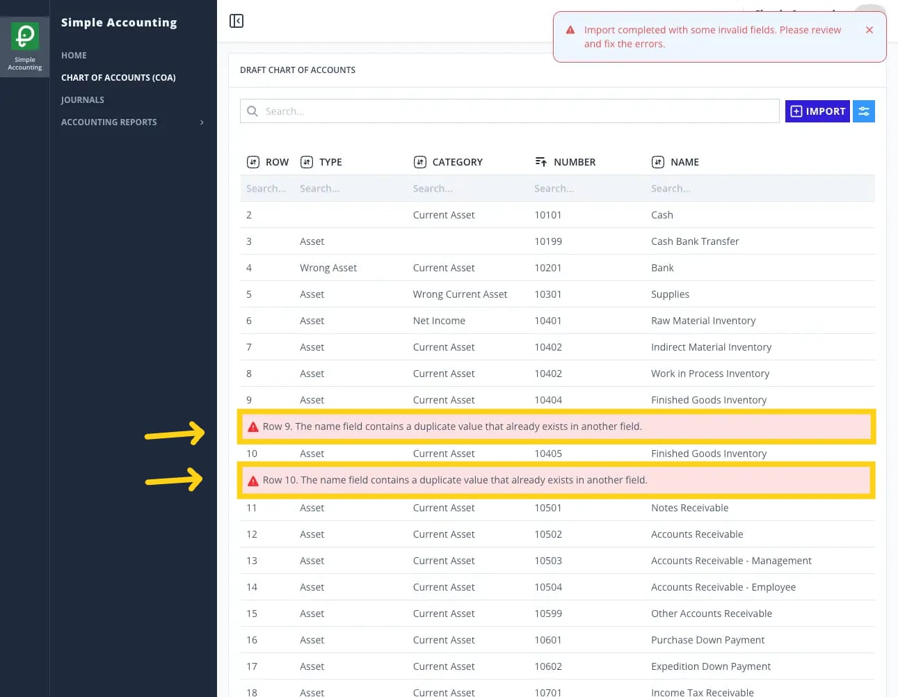

# Scenario 3.1. Import Chart of Account

## 3.1.F4. COA import fails when COA name already exists.

- `GIVEN` user already logged in
- `AND` user visit home
- `WHEN` user click menu "Chart of Accounts"

{.shadow-img}

- `THEN` user redirected to list chart of account page
- `WHEN` user click import button

{.shadow-img}

- `THEN` user redirected to import chart of account page
- `WHEN` user upload csv file in the upload form

{.shadow-img}

- `WHEN` user click save button

{.shadow-img}

- `THEN` user sees notification "Import completed with some invalid fields. Please review and fix the errors"

{.shadow-img}

- `THEN` user sees error message "Row 9. The name field contains a duplicate value that already exists in another field."
- `AND` user sees error message "Row 10. The name field contains a duplicate value that already exists in another field."

{.shadow-img}