# Scenario 3.1. Import Chart of Account

## 3.1.S2. User can fix failed import chart of accounts (COA) successfully.

- `GIVEN` user already logged in
- `AND` user visit home
- `WHEN` user click menu "Chart of Accounts"

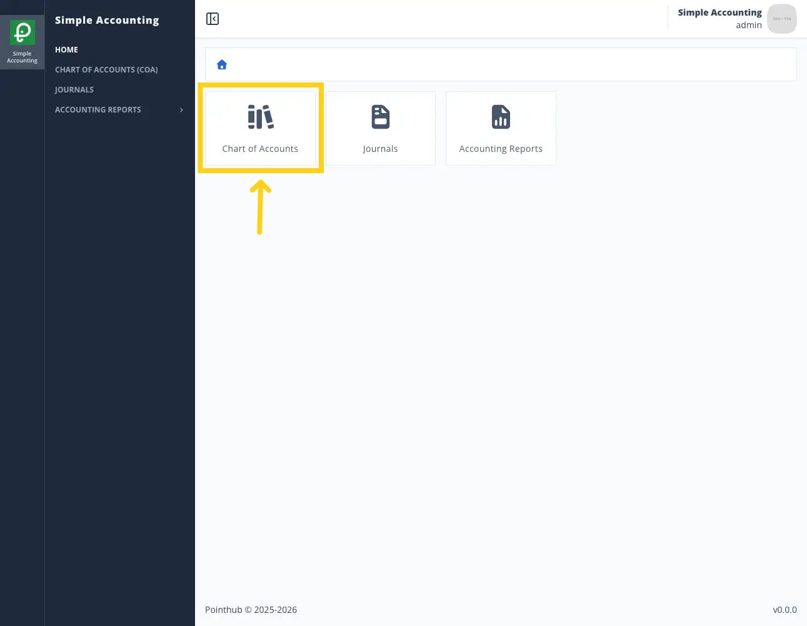{.shadow-img}

- `THEN` user redirected to list chart of account page
- `WHEN` user click import button

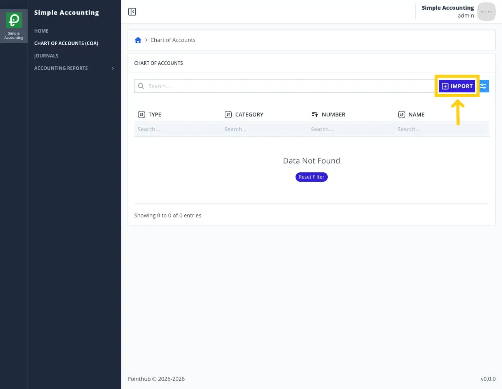{.shadow-img}

- `THEN` user redirected to import chart of account page
- `WHEN` user click instruction button

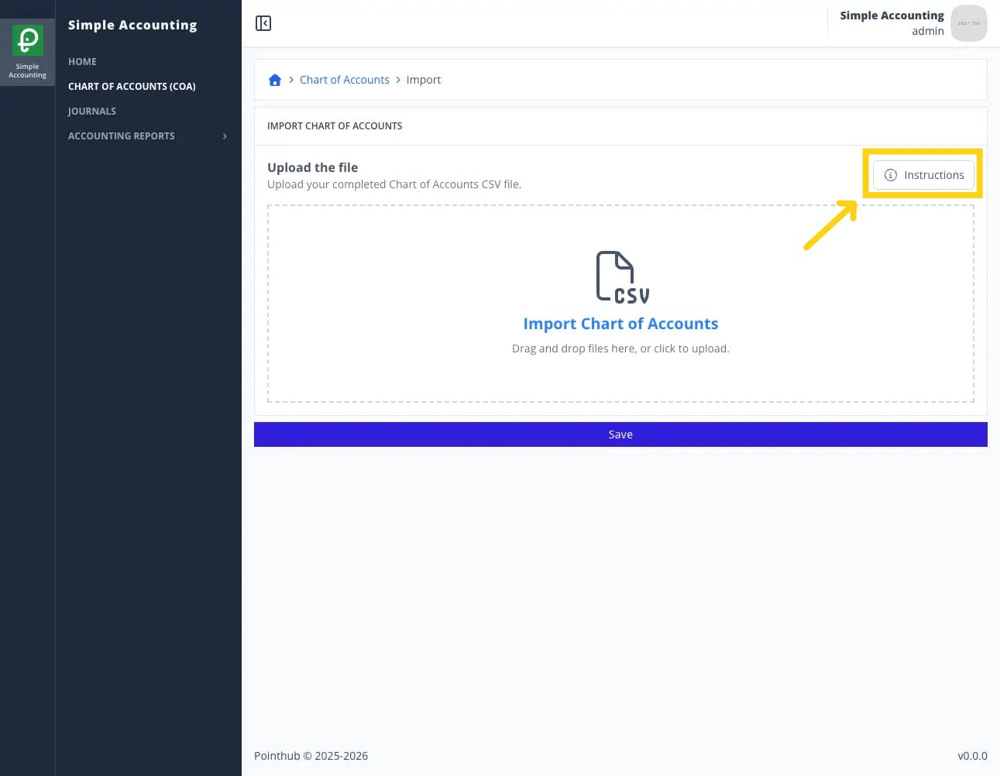{.shadow-img}

- `THEN` user sees popup import instructions

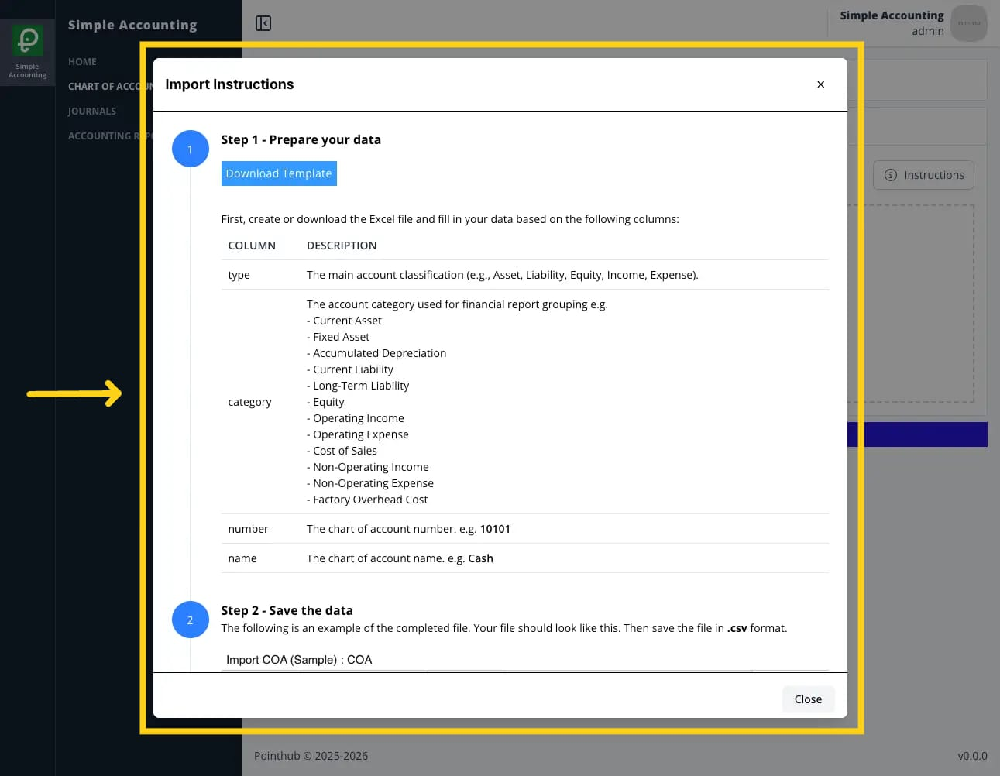{.shadow-img}

- `WHEN` user click close button

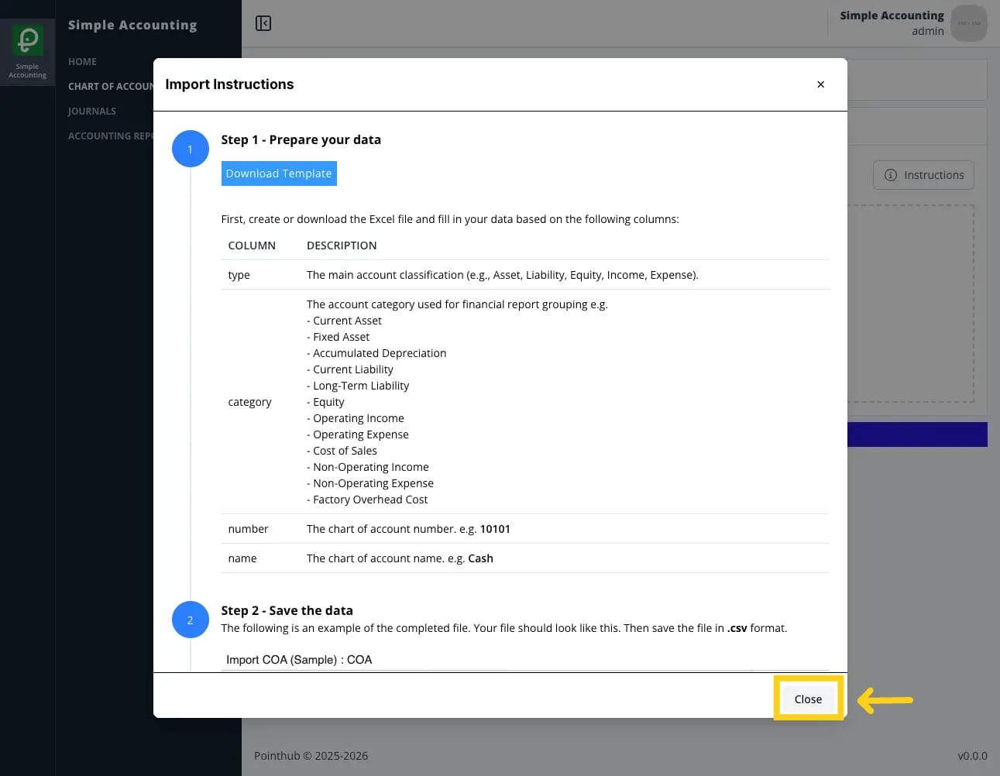{.shadow-img}

- `THEN` user sees popup import instructions disappear
- `WHEN` user upload csv file in the upload form

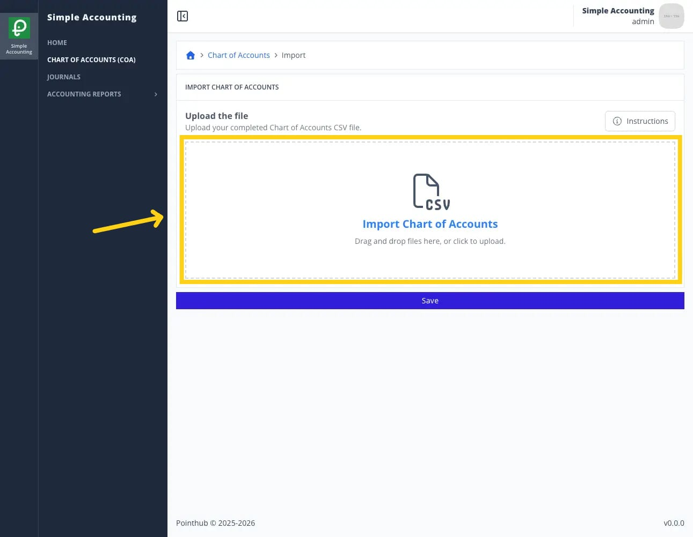{.shadow-img}

- `WHEN` user click save button

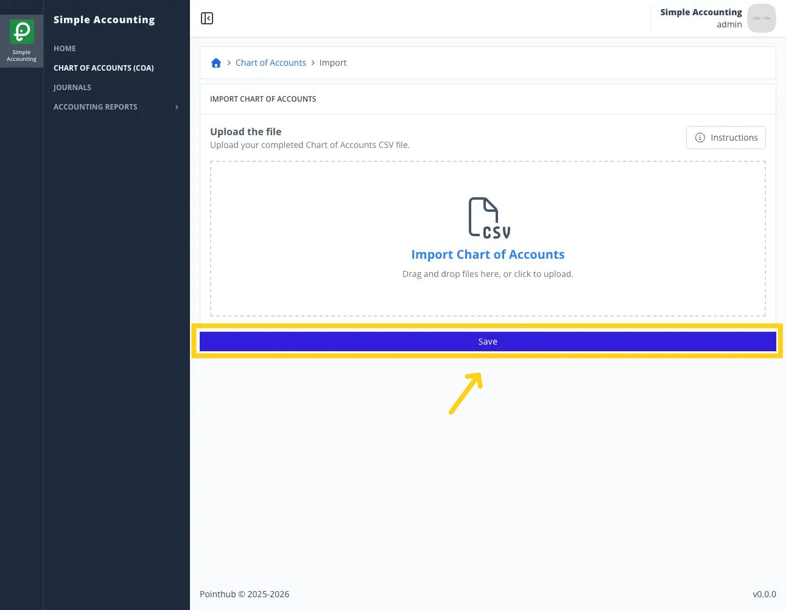{.shadow-img}

- `THEN` user sees notification "Import completed with some invalid fields. Please review and fix the errors"

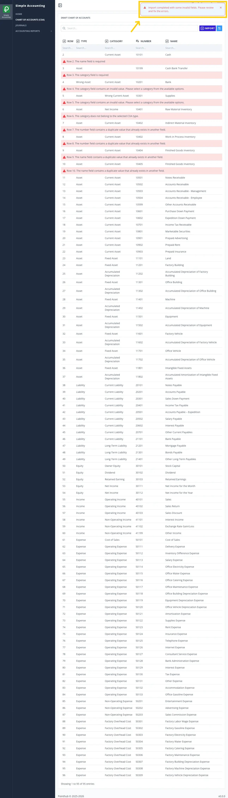{.shadow-img}

- `THEN` user sees error message "Row 2. The name field is required."
- `AND` user sees error message "Row 3. The category field is required."
- `AND` user sees error message "Row 7. The number field contains a duplicate value that already exists in another field."
- `AND` user sees error message "Row 8. The number field contains a duplicate value that already exists in another field."
- `AND` user sees error message "Row 9. The name field contains a duplicate value that already exists in another field."
- `AND` user sees error message "Row 10. The name field contains a duplicate value that already exists in another field."
- `AND` user sees error message "Row 4. The category field contains an invalid value. Please select a category from the available options."
- `AND` user sees error message "Row 5. The category field contains an invalid value. Please select a category from the available options."
- `AND` user sees error message "Row 6. The category does not belong to the selected COA type."

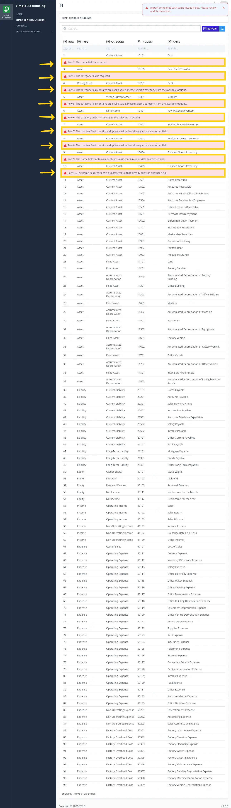{.shadow-img}

- `WHEN` user enters "Asset" in the type field in row 2
- `AND` user enters "Current Asset" in the category field in row 3
- `AND` changes from "Wrong Asset" to "Asset" in the type field in row 4
- `AND` changes from "Wrong Current Asset" to "Current Asset" in the category field in row 5
- `AND` changes from "Net Income" to "Current Asset" in the category field in row 6
- `AND` changes from "10402" to "10403" in the number field in row 8
- `AND` changes from "Finished Goods Inventory" to "Inventory in Distribution" in the name field in row 10

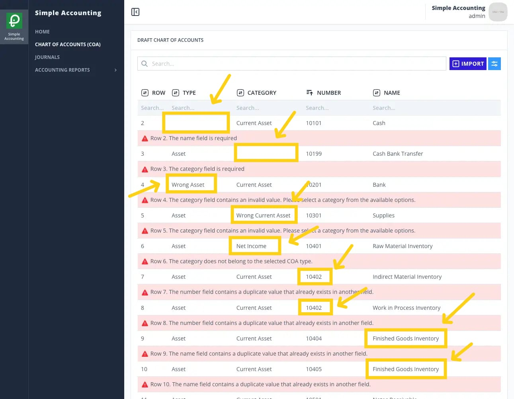{.shadow-img}

- `WHEN` user click save button

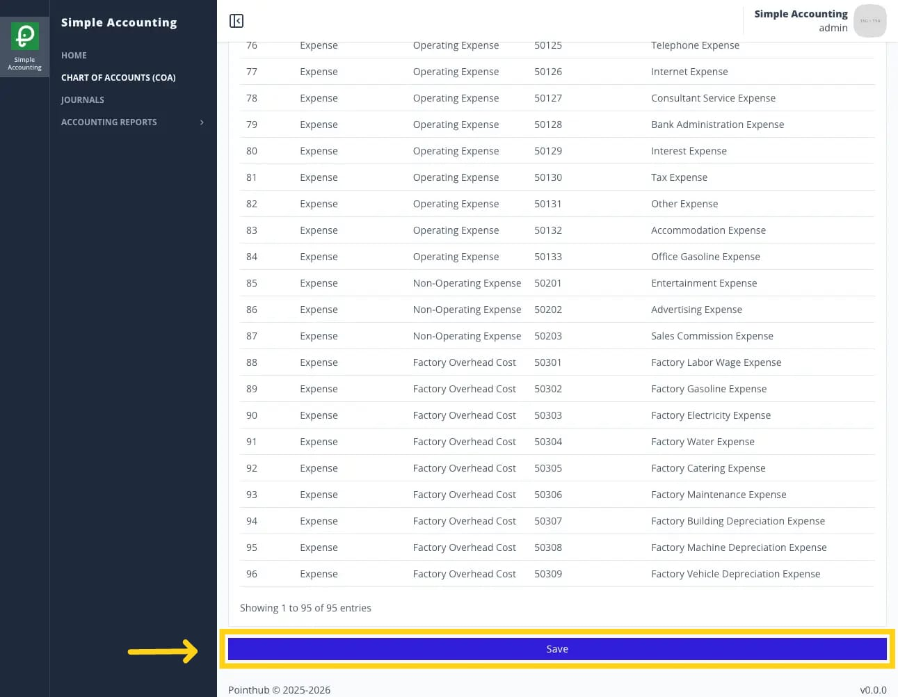{.shadow-img}

- `THEN` user sees notification "Import success"

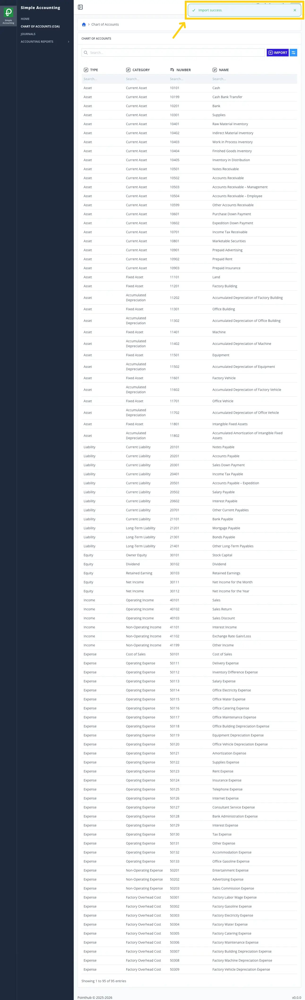{.shadow-img}

