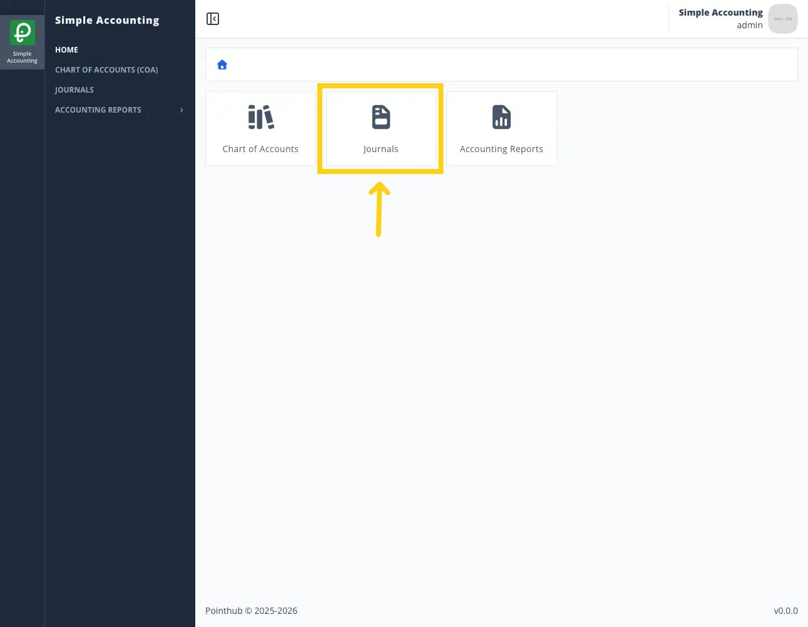
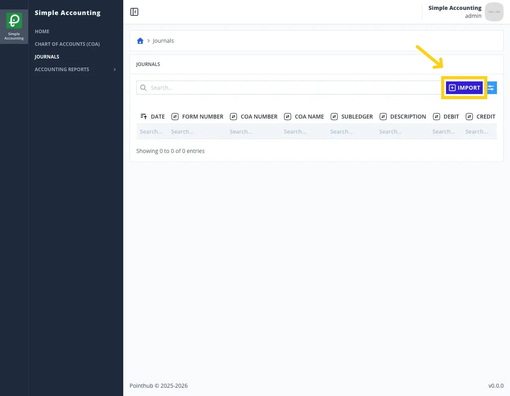
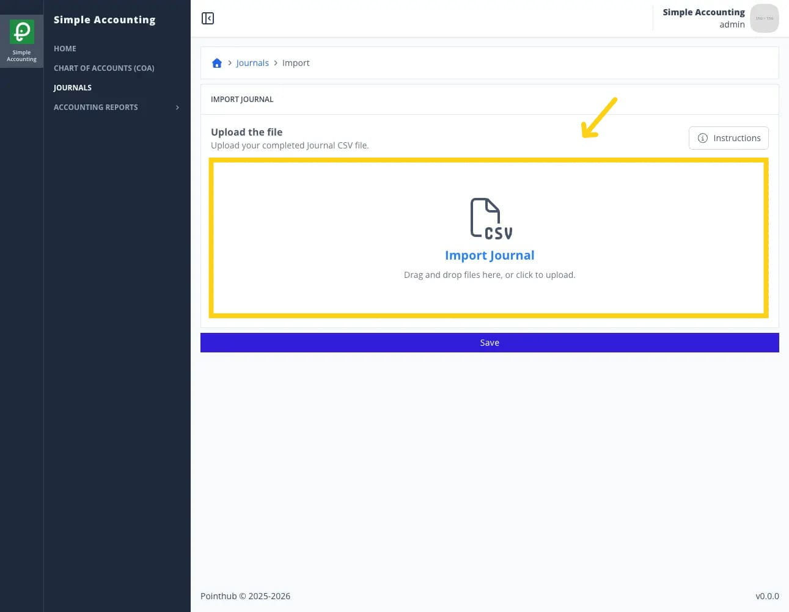
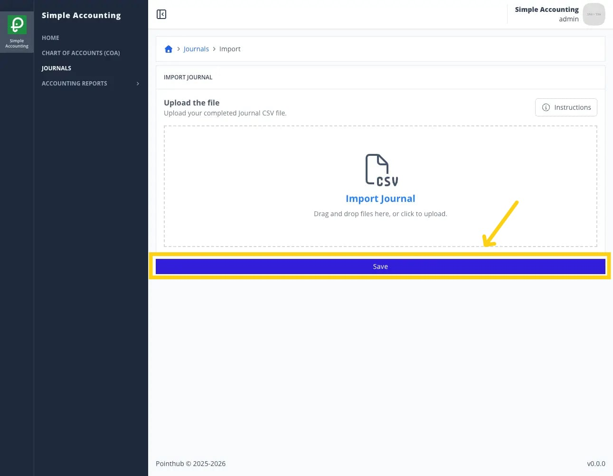
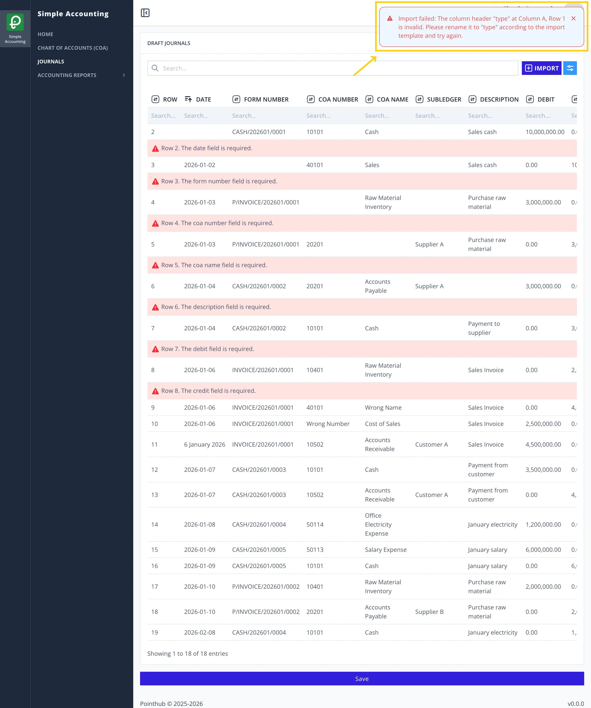
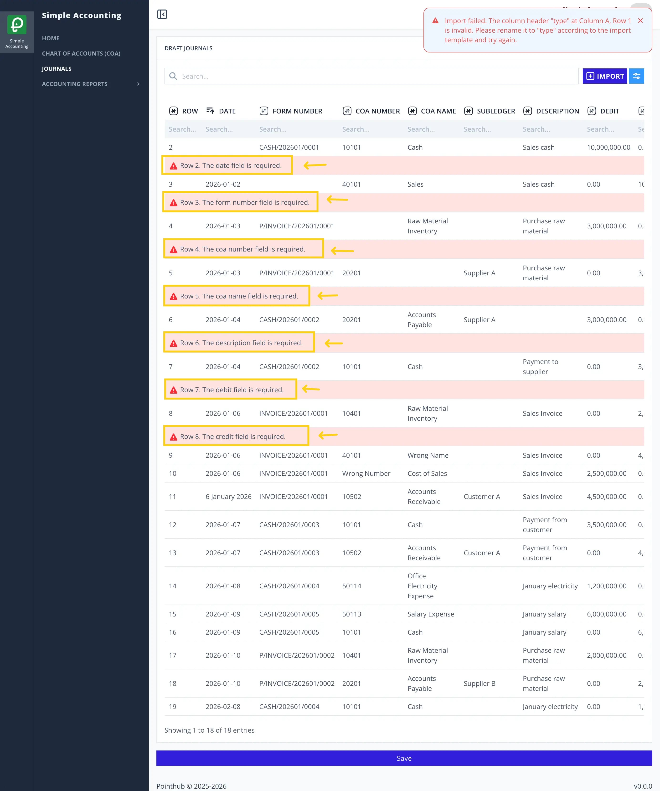

# Scenario 4.1. Import Journals

## 4.1.F2. Journal import fails when required fields are empty.

- `GIVEN` user already logged in
- `AND` user visit home
- `WHEN` user click menu "Journals"

{.shadow-img}

- `THEN` user redirected to list journals page
- `WHEN` user click import button

{.shadow-img}

- `THEN` user redirected to import journals page
- `WHEN` user upload csv file in the upload form

{.shadow-img}

- `WHEN` user click save button

{.shadow-img}

- `THEN` user see notification "Import completed with some invalid fields. Please review and fix the errors"

{.shadow-img}

- `THEN` user sees error message "Row 2. The date field is required."
- `AND` user sees error message "Row 3. The form number field is required."
- `AND` user sees error message "Row 4. The coa number field is required."
- `AND` user sees error message "Row 5. The coa name field is required."
- `AND` user sees error message "Row 6. The description field is required."
- `AND` user sees error message "Row 7. The debit field is required."
- `AND` user sees error message "Row 8. The credit field is required."

{.shadow-img}
