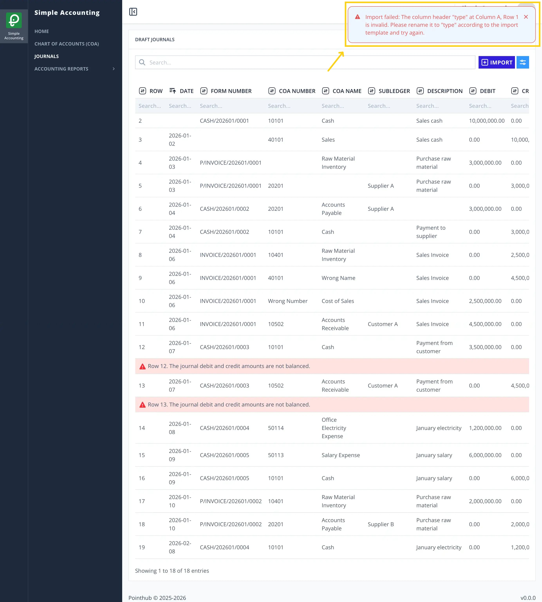
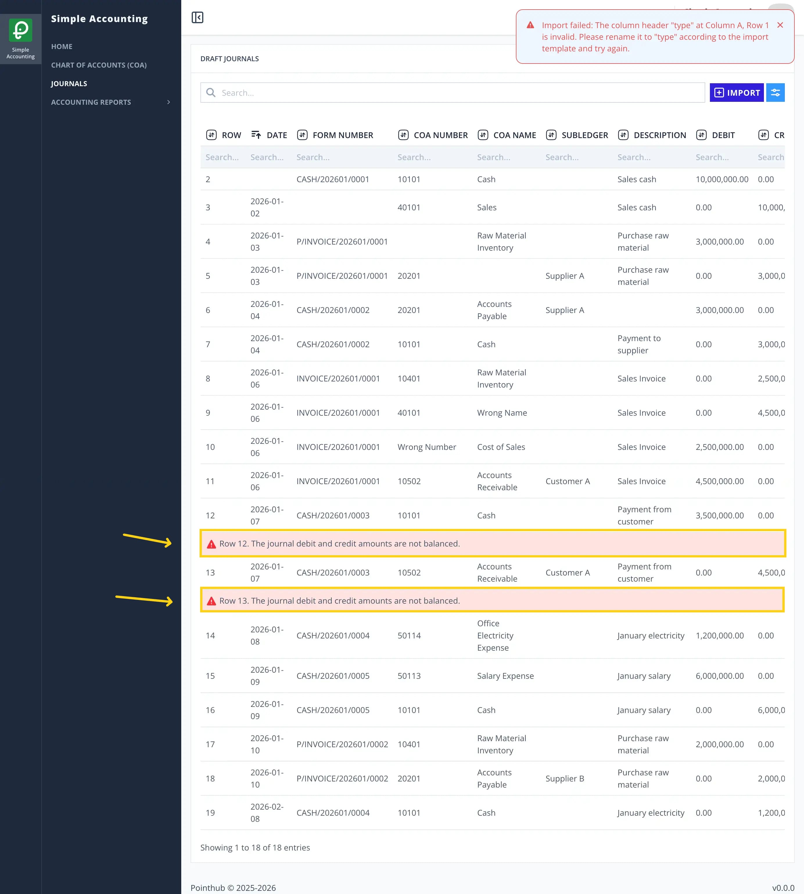

# Scenario 4.1. Import Journals

## 4.1.F4. Journal import fails when debit and credit amounts are not balanced.

- `GIVEN` user already logged in
- `AND` user visit home
- `WHEN` user click menu "Journals"

{.shadow-img}

- `THEN` user redirected to list journals page
- `WHEN` user click import button

{.shadow-img}

- `THEN` user redirected to import journals page
- `WHEN` user upload csv file in the upload form

{.shadow-img}

- `WHEN` user click save button

{.shadow-img}

- `THEN` user see notification "Import completed with some invalid fields. Please review and fix the errors"

{.shadow-img}

- `THEN` user sees error message "Row 12. The journal debit and credit amounts are not balanced."
- `AND` user sees error message "Row 13. The journal debit and credit amounts are not balanced."

{.shadow-img}
