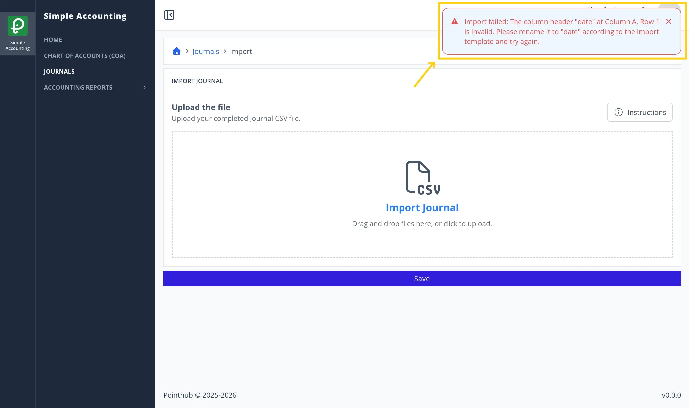

# Scenario 4.1. Import Journals

Reference: [ADR#005](/architecture-decision-records/005/)

## 4.1.F7. Journal import fails when the headers are invalid.

- `GIVEN` user already logged in
- `AND` user visit home
- `WHEN` user click menu "Journals"

{.shadow-img}

- `THEN` user redirected to list journals page
- `WHEN` user click import button

{.shadow-img}

- `THEN` user redirected to import journals page
- `WHEN` user upload csv file in the upload form

{.shadow-img}

- `WHEN` user click save button

{.shadow-img}

- `THEN` user see notification "Import failed: The column header "date" at Column A, Row 1 is invalid. Please rename it to "date" according to the import template and try again."

{.shadow-img}
