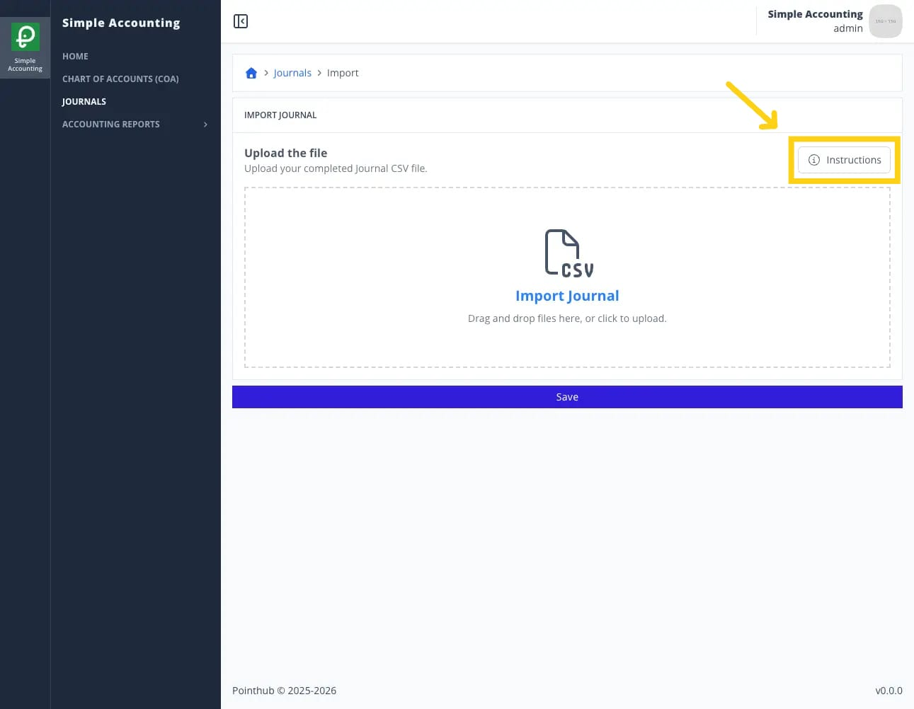
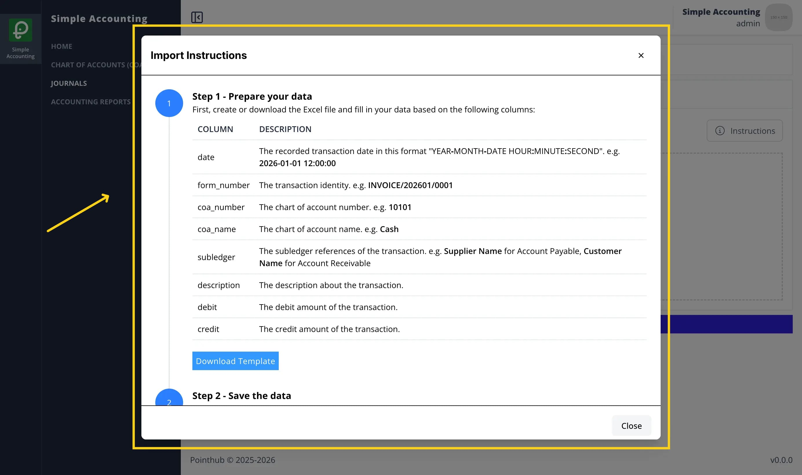
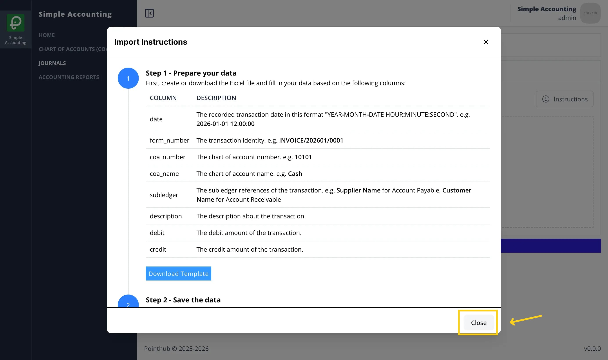
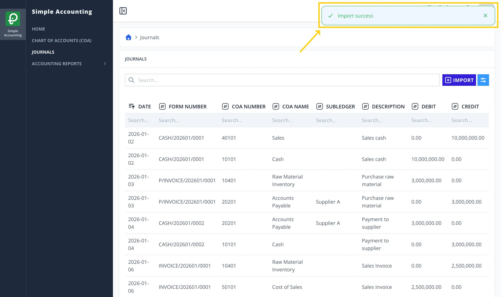

# Scenario 4.1. Import Journals

## 4.1.S1. User can import journals successfully.

- `GIVEN` user already logged in
- `AND` user visit home
- `WHEN` user click menu "Journals"

{.shadow-img}

- `THEN` user redirected to list journals page
- `WHEN` user click import button

{.shadow-img}

- `THEN` user redirected to import journals page
- `WHEN` user click instruction button

{.shadow-img}

- `THEN` user sees popup import instructions

{.shadow-img}

- `WHEN` user click close button

{.shadow-img}

- `THEN` user sees popup import instructions disappear
- `WHEN` user upload csv file in the upload form

{.shadow-img}

- `WHEN` user click save button

{.shadow-img}

- `THEN` user see notification "Import success"

{.shadow-img}