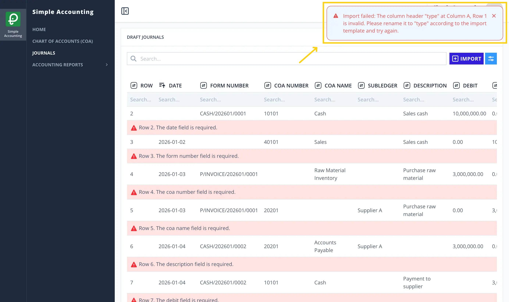
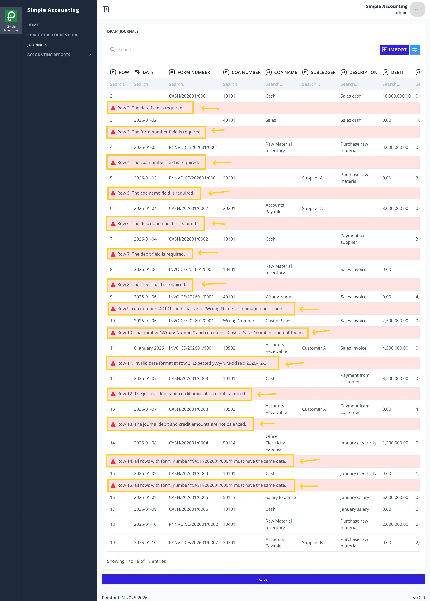
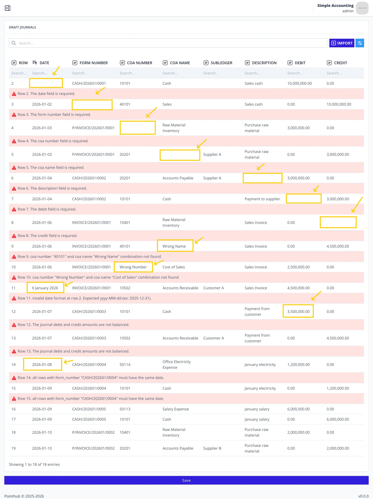
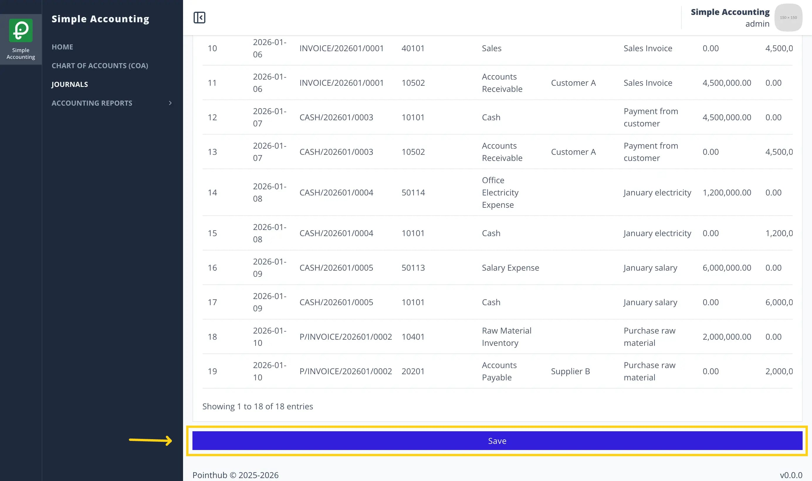

# Scenario 4.1. Import Journals

## 4.1.S2. User can fix failed import journals successfully.

- `GIVEN` user already logged in
- `AND` user visit home
- `WHEN` user click menu "Journals"

{.shadow-img}

- `THEN` user redirected to list journals page
- `WHEN` user click import button

{.shadow-img}

- `THEN` user redirected to import journals page
- `WHEN` user click instruction button

{.shadow-img}

- `THEN` user sees popup import instructions

{.shadow-img}

- `WHEN` user click close button

{.shadow-img}

- `THEN` user sees popup import instructions disappear
- `WHEN` user upload csv file in the upload form

{.shadow-img}

- `WHEN` user click save button

{.shadow-img}

- `THEN` user see notification "Import completed with some invalid fields. Please review and fix the errors"

{.shadow-img}

- `THEN` user sees error message "Row 2. The date field is required."
- `AND` user sees error message "Row 3. The form number field is required."
- `AND` user sees error message "Row 4. The coa number field is required."
- `AND` user sees error message "Row 5. The coa name field is required."
- `AND` user sees error message "Row 6. The description field is required."
- `AND` user sees error message "Row 7. The debit field is required."
- `AND` user sees error message "Row 8. The credit field is required."
- `AND` user sees error message "Row 9. coa number "40101" and coa name "Wrong Name" combination not found."
- `AND` user sees error message "Row 10. coa number "Wrong Number" and coa name "Cost of Sales" combination not found."
- `AND` user sees error message "Row 11. invalid date format at row 2. Expected yyyy-MM-dd (ex: 2025-12-31)"
- `AND` user sees error message "Row 12. The journal debit and credit amounts are not balanced."
- `AND` user sees error message "Row 13. The journal debit and credit amounts are not balanced."
- `AND` user sees error message "Row 14. all rows with form_number "CASH/202601/0004" must have the same date."
- `AND` user sees error message "Row 15. all rows with form_number "CASH/202601/0004" must have the same date."

{.shadow-img}

- `WHEN` user enters "2026-01-02" in the date field in row 2
- `WHEN` user enters "CASH/202601/0001" in the form_number field in row 3
- `WHEN` user enters "10401" in the coa number field in row 4
- `WHEN` user enters "Accounts Payable" in the coa name field in row 5
- `WHEN` user enters "Payment to supplier" in the description field in row 6
- `WHEN` user enters "4,500,000.00" in the debit field in row 7
- `WHEN` user enters "4,500,000.00" in the credit field in row 8
- `AND` changes from "Wrong Name" to "Sales" in the coa name field in row 9
- `AND` changes from "Wrong Number" to "50101" in the coa number field in row 10
- `AND` changes from "6 January 2026" to "2026-01-06" in the date field in row 11
- `AND` changes from "3,500,000.00" to "4,500,000.00" in the type field in row 12
- `AND` changes from "2026-01-08" to "2026-01-09" in the type field in row 14

{.shadow-img}

- `WHEN` user click save button

{.shadow-img}

- `THEN` user sees notification "Import success"

{.shadow-img}
