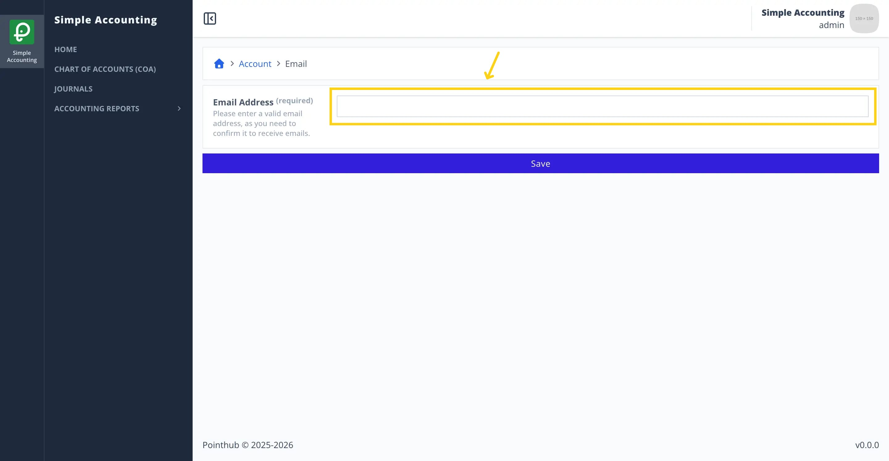
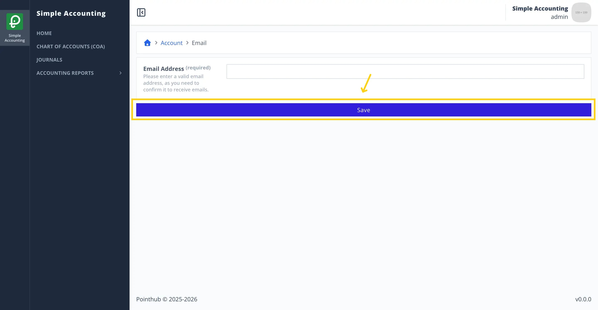
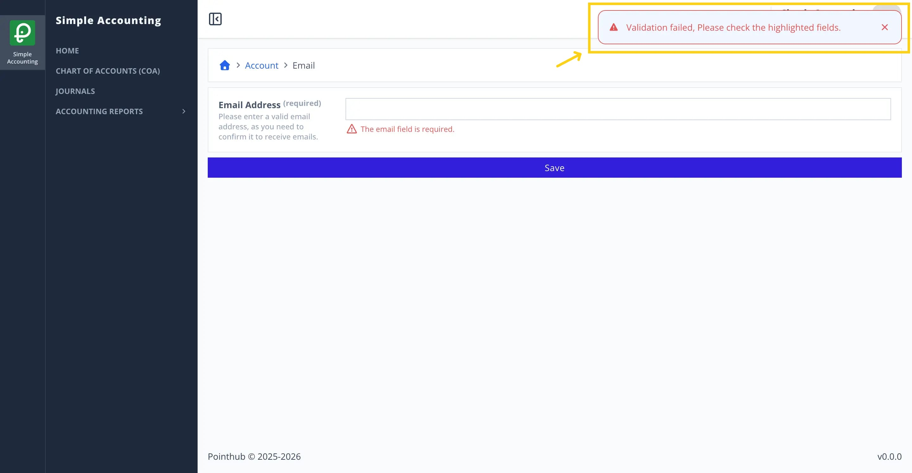
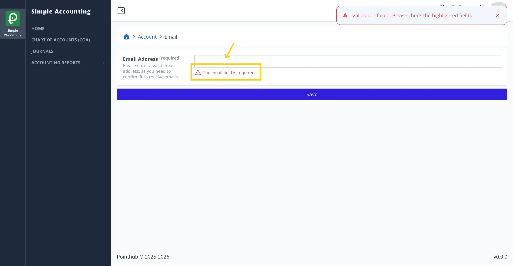

# Scenario 2.2. Update Email

## 2.2.F2. Email update fails when required fields are empty.

- `GIVEN` user already logged in
- `AND` user visit home
- `WHEN` user click top right menu button

{.shadow-img}

- `THEN` user sees the popup menu
- `WHEN` user click my account button

{.shadow-img}

- `THEN` user redirected to account page
- `WHEN` user click email button

{.shadow-img}

- `THEN` user redirected to update email page

{.shadow-img}

- `WHEN` user clears email input

{.shadow-img}

- `WHEN` user click save button

{.shadow-img}

- `THEN` user sees error notification "Validation failed, Please check the highlighted fields."

{.shadow-img}

- `THEN` user sees error message "The email field is required."

{.shadow-img}
