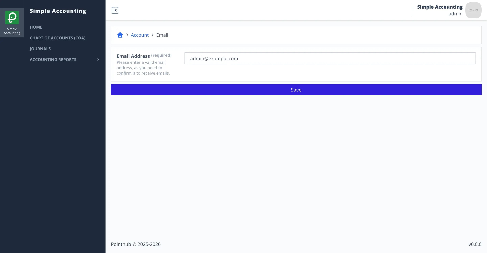
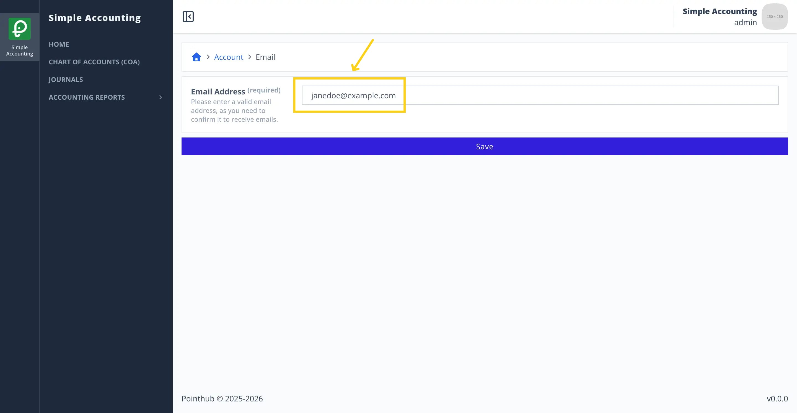
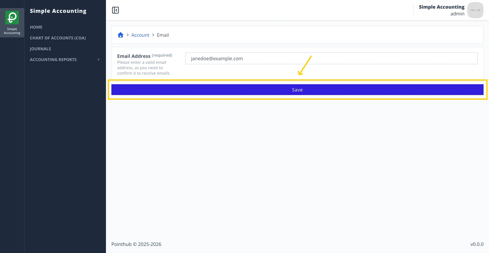
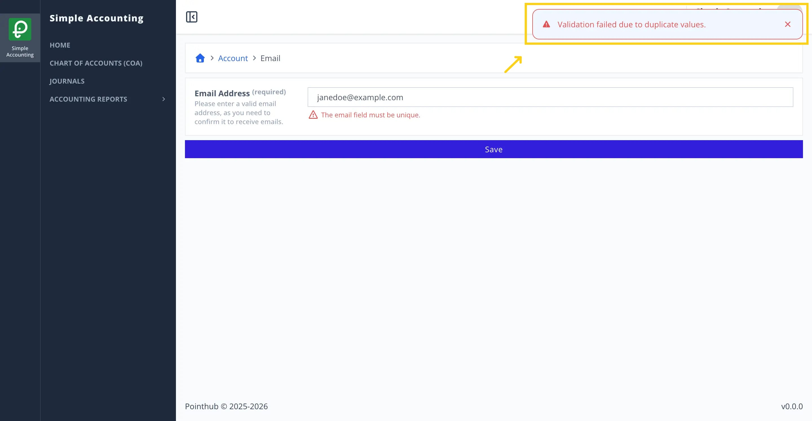
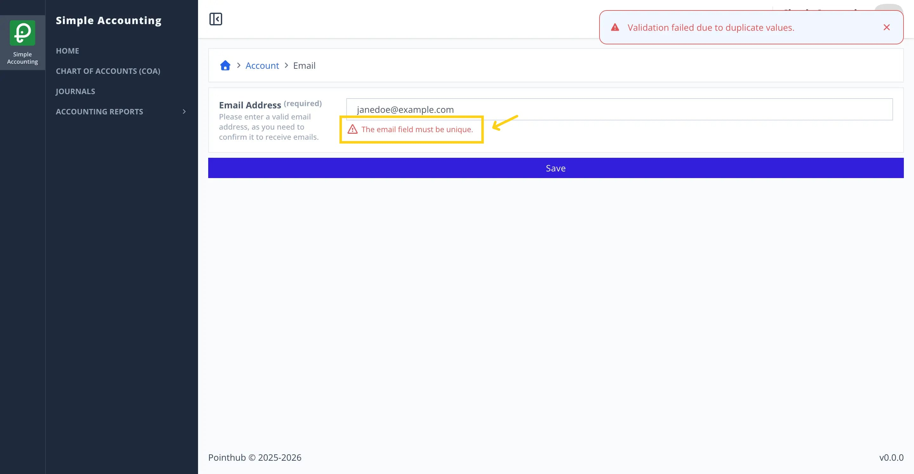

# Scenario 2.2. Update Email

## 2.2.F3. Email update fails when email already exists.

- `GIVEN` user already logged in
- `AND` user visit home
- `WHEN` user click top right menu button

{.shadow-img}

- `THEN` user sees the popup menu
- `WHEN` user click my account button

{.shadow-img}

- `THEN` user redirected to account page
- `WHEN` user click email button

{.shadow-img}

- `THEN` user redirected to update email page

{.shadow-img}

- `WHEN` user changes email input from "admin@example.com" to "janedoe@example.com"

{.shadow-img}

- `WHEN` user click save button

{.shadow-img}

- `THEN` user sees error notification "Validation failed due to duplicate values."

{.shadow-img}

- `THEN` user sees error message "The email field must be unique."

{.shadow-img}