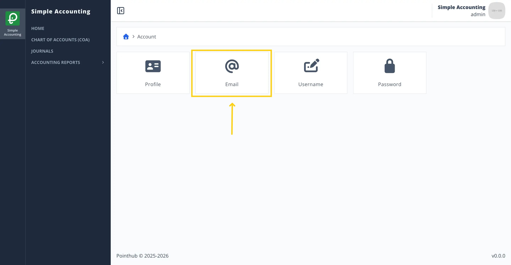
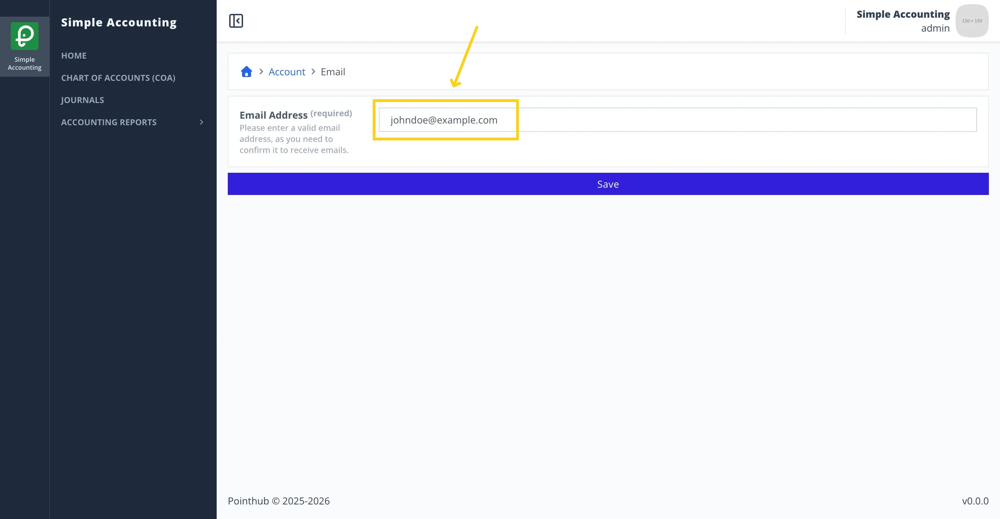
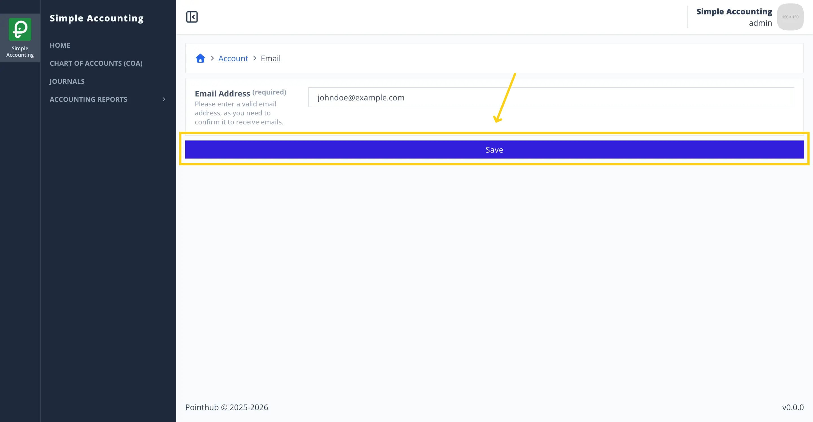
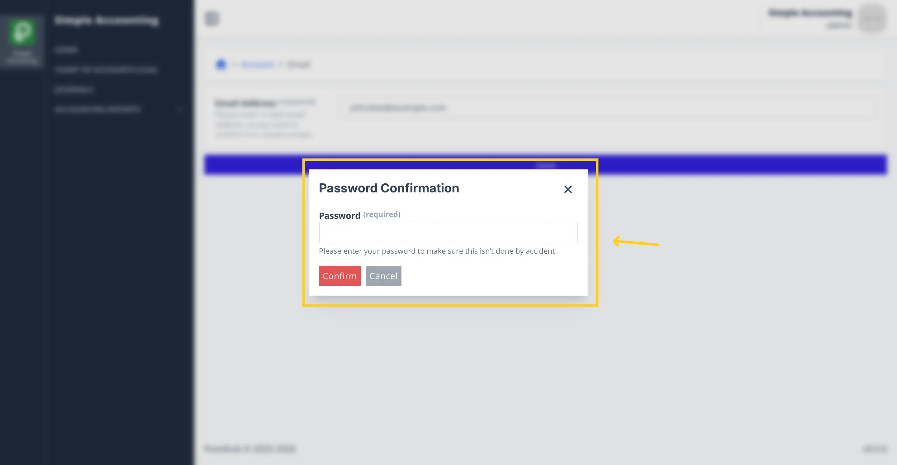
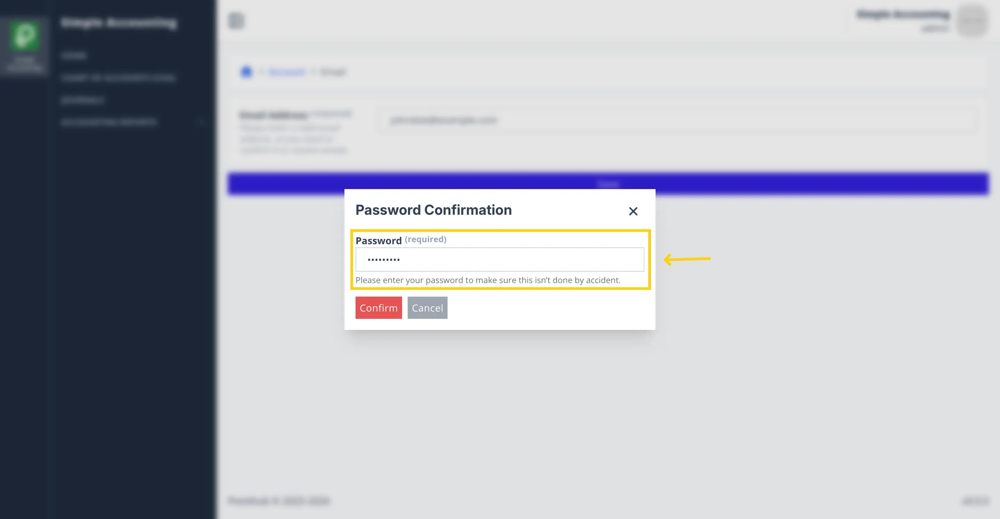
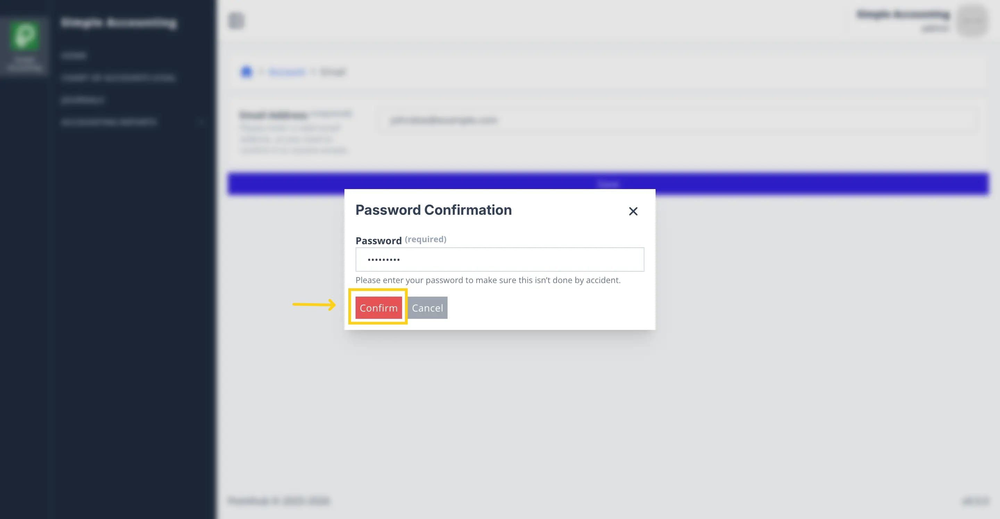
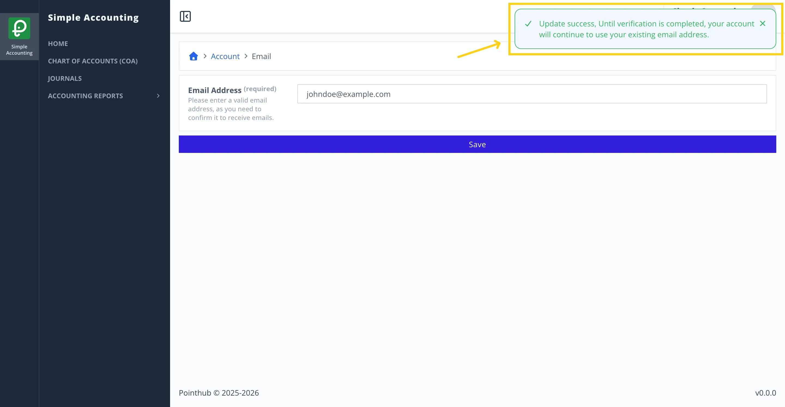

# Scenario 2.1. Update Email

## 2.1.S1. User can update email successfully.

- `GIVEN` user already logged in
- `AND` user visit home
- `WHEN` user click top right menu button

{.shadow-img}

- `THEN` user sees the popup menu
- `WHEN` user click my account button

{.shadow-img}

- `THEN` user redirected to account page
- `WHEN` user click email button

{.shadow-img}

- `THEN` user redirected to update email page

{.shadow-img}

- `WHEN` user changes email input from "admin@example.com" to "johndoe@example.com"

{.shadow-img}

- `WHEN` user click save button

{.shadow-img}

- `THEN` user sees popup password confirmation

{.shadow-img}

- `WHEN` user types "Admin123!" in the password input

{.shadow-img}

- `WHEN` user clicks confirm button

{.shadow-img}

- `THEN` user sees success notification "Update success, Until verification is completed, your account will continue to use your existing email address."

{.shadow-img}