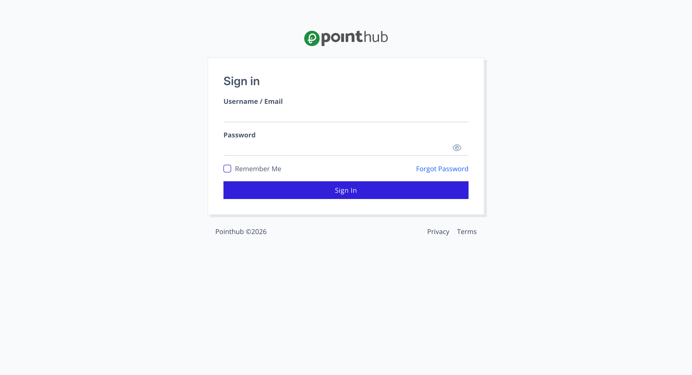

# Scenario 2.3. Update Password

## 2.3.F1. Password update fails when user is not authenticated.

- `GIVEN` user visit `/my-account/update-password` url without signin
- `THEN` user redirected to `Sign In` page

{.shadow-img}