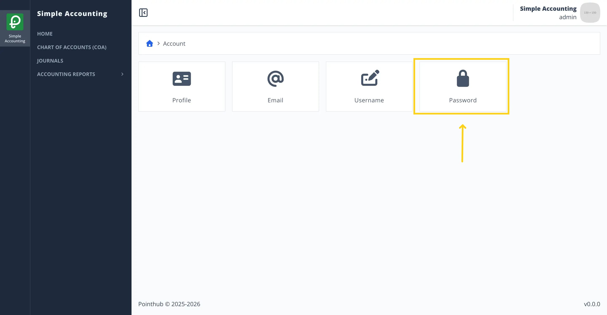
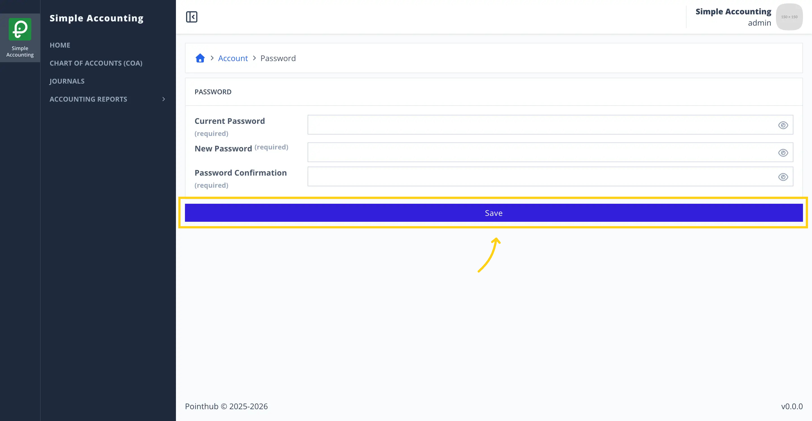
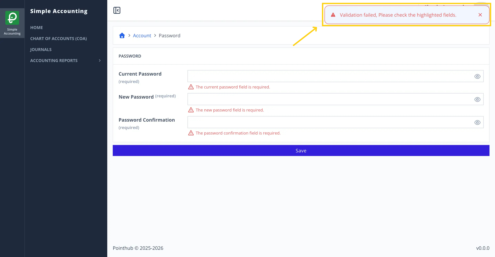
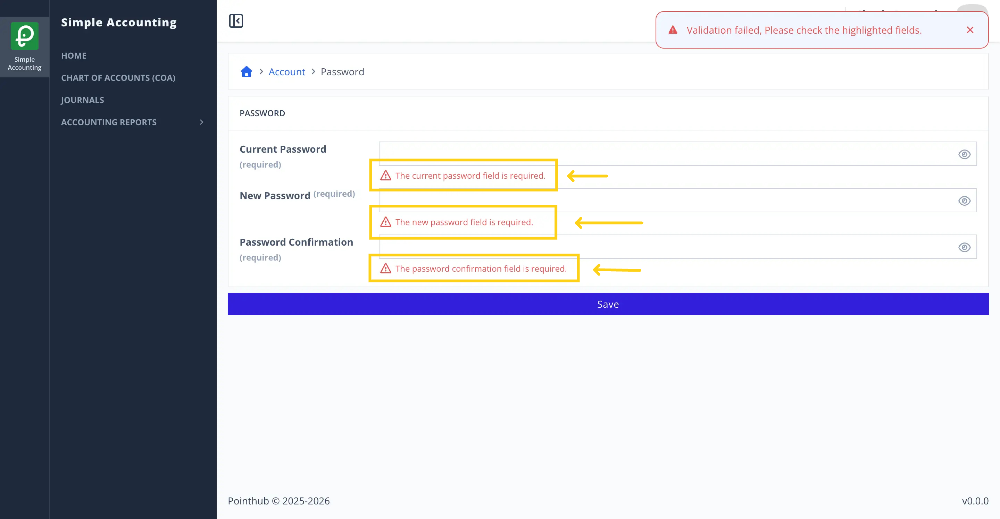

# Scenario 2.1. Update Password

## 2.3.F2. Password update fails when required fields are empty.

- `GIVEN` user already logged in
- `AND` user visit home
- `WHEN` user click top right menu button

{.shadow-img}

- `THEN` user sees the popup menu
- `WHEN` user click my account button

{.shadow-img}

- `THEN` user redirected to account page
- `WHEN` user click password button

{.shadow-img}

- `THEN` user redirected to update password page
- `WHEN` user clicks save button

{.shadow-img}

- `THEN` user sees error notification "Validation failed, Please check the highlighted fields."

{.shadow-img}

- `THEN` user sees error message "The current password field is required."
- `AND` user sees error message "The new password field is required."
- `AND` user sees error message "The password confirmation field is required."

{.shadow-img}