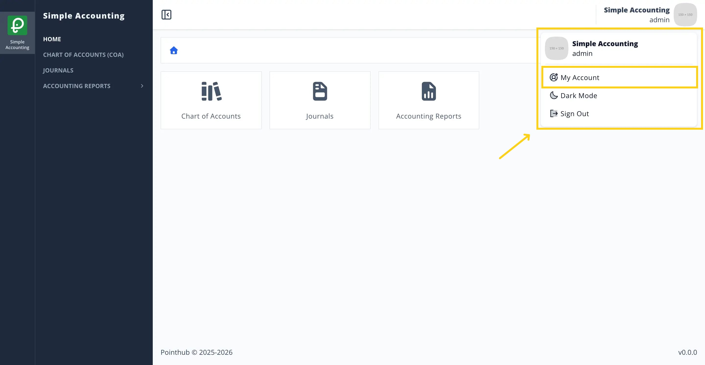
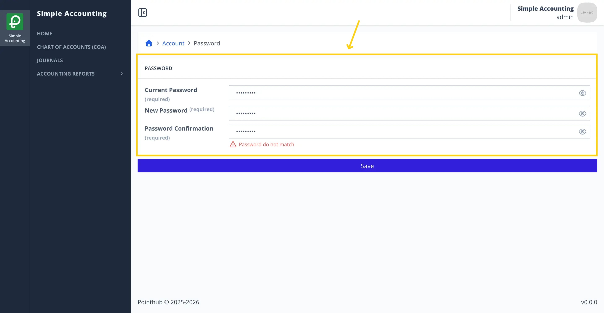

# Scenario 2.3. Update Password

## 2.3.F4. Password update fails when password confirmation does not match.

- `GIVEN` user already logged in
- `AND` user visit home
- `WHEN` user click top right menu button

{.shadow-img}

- `THEN` user sees the popup menu
- `WHEN` user click my account button

{.shadow-img}

- `THEN` user redirected to account page
- `WHEN` user click password button

{.shadow-img}

- `THEN` user redirected to update password page

{.shadow-img}

- `WHEN` user types "Admin123!" in the current password field
- `AND` user types "Admin123@" in the new password field
- `AND` user types "Admin123#" in the password confirmation field
- `THEN` user sees error message "Password do not match"

{.shadow-img}