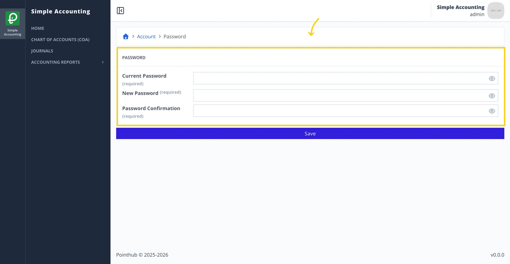
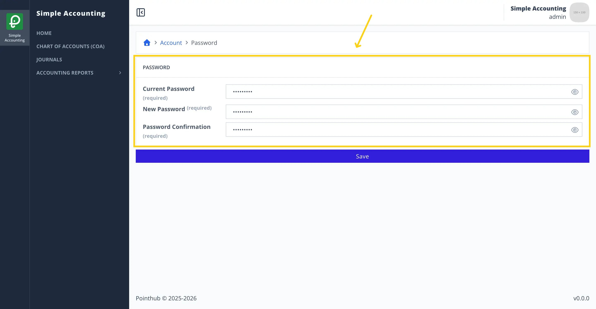
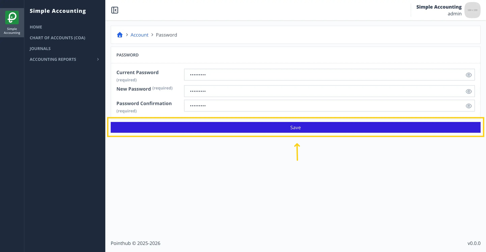
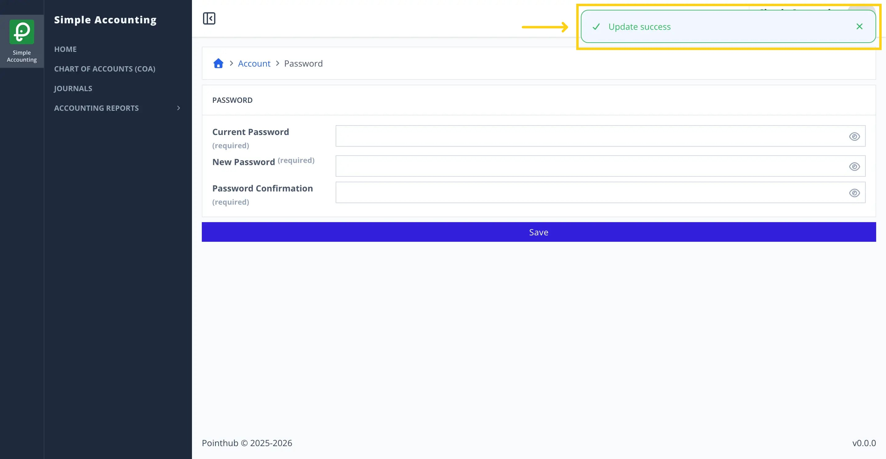

# Scenario 2.3. Update Password

## 2.3.S1. User can update password successfully.

- `GIVEN` user already logged in
- `AND` user visit home
- `WHEN` user click top right menu button

{.shadow-img}

- `THEN` user sees the popup menu
- `WHEN` user click my account button

{.shadow-img}

- `THEN` user redirected to account page
- `WHEN` user click password button

{.shadow-img}

- `THEN` user redirected to update password page

{.shadow-img}

- `WHEN` user types "Admin123!" in the current password input 
- `AND` user types "Admin123@" in the new password input 
- `AND` user types "Admin123@" in the password confirmation input 

{.shadow-img}

- `WHEN` user click save button

{.shadow-img}

- `THEN` user sees success notification "Update success"

{.shadow-img}
