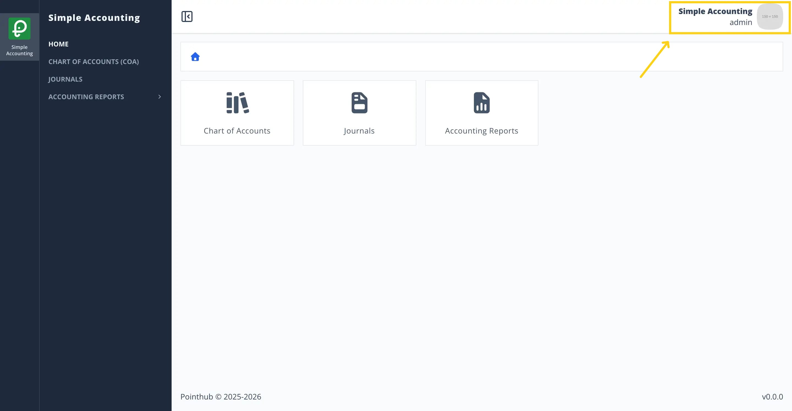
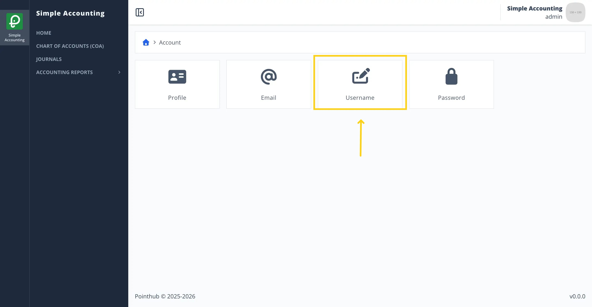
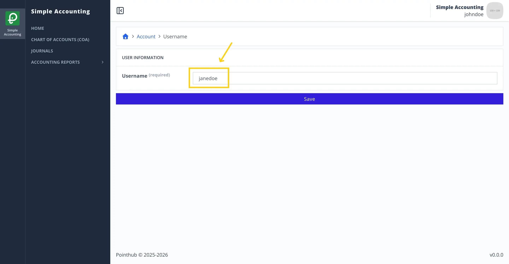
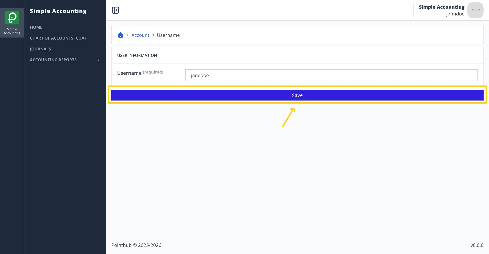
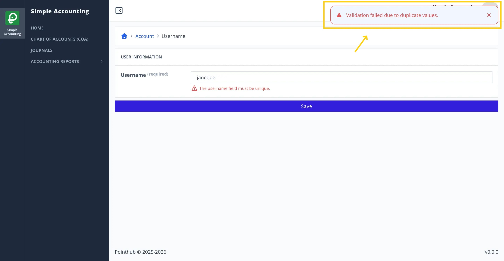
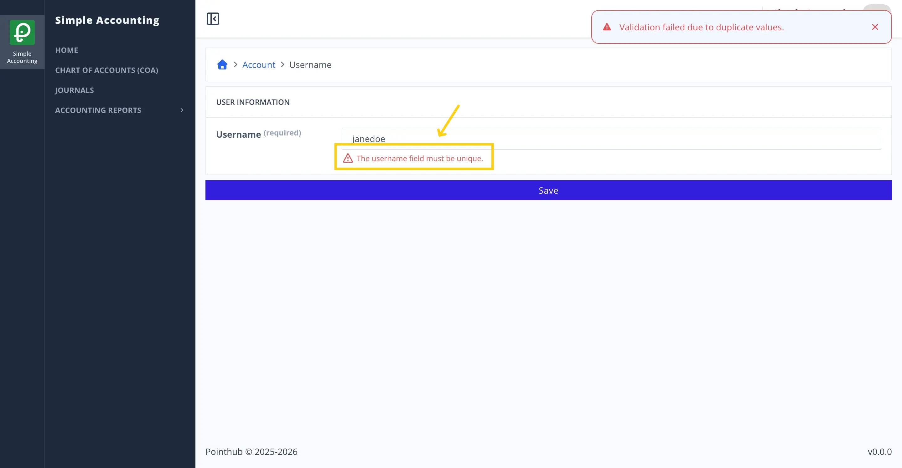

# Scenario 2.1. Update Username

## 2.1.F3. Username update fails when username already exists.

- `GIVEN` user already logged in
- `AND` user visit home
- `WHEN` user click top right menu button

{.shadow-img}

- `THEN` user sees the popup menu
- `WHEN` user click my account button

{.shadow-img}

- `THEN` user redirected to account page
- `WHEN` user click username button

{.shadow-img}

- `THEN` user redirected to update username page

{.shadow-img}

- `WHEN` user changes username input from "admin" to "janedoe"

{.shadow-img}

- `WHEN` user click save button

{.shadow-img}

- `THEN` user sees error notification "Validation failed due to duplicate values."

{.shadow-img}

- `THEN` user sees error message "The username field must be unique."

{.shadow-img}